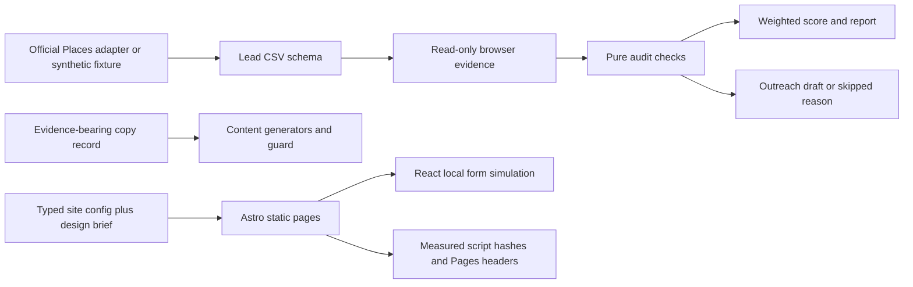

# Architecture

The workflow separates **observation**, **decision**, and **presentation**. A provider response becomes a lead row; browser observations become check verdicts; verdicts feed a score and reviewable drafts. None of those steps sends a message or deploys a website.

## Discovery boundary

`packages/discover/src/places.ts` owns the official `searchText` adapter, not web scraping. Its `fetchImpl` is injectable for deterministic tests. A run-level `CallBudget` reserves calls before HTTP; `maxCalls` bounds thin-page pagination independently of result count. Field masks travel with requests so usage accounting can be checked against what was sent. Errors redact the supplied API key. Optional response fields remain empty in the lead schema rather than being inferred.

## Audit boundary

`probe.ts` captures desktop and mobile evidence through Playwright. `lighthouse.ts` optionally attaches to the same CDP browser. A `NavigationBudget` caps/rate-limits navigations and link probes. `checks.ts` evaluates a `SiteEvidence` value without doing I/O. Every check returns `pass`, `fail`, or `unavailable`; an unreachable page produces only `unavailable` results.

`score.ts` computes the share of decided check weight that failed and combines it with a rating/review heuristic. Undecided checks contribute no weight. Missing rating data uses a disclosed neutral multiplier. Reports retain evidence and skipped reasons. Cache keys include a check version to avoid mixing changed rules with old results.

The offline fixture calls these same checks with explicitly simulated evidence. It deliberately omits Lighthouse scores. The browser suite separately validates the built website rather than claiming the fixture measured it.

## Draft and copy boundaries

`outreach/src/pitch.ts` requires two confirmed findings and filters navigation headings out of service lists. The draft contains those findings and their evidence, plus an explicit mockup placeholder. There is no SMTP, email API or automatic sending path.

`copy` keeps `Fact<T>` separate from `Unconfirmed`; a fact requires a nonempty evidence reference. Generators use that record to produce copy and conspicuous verification markers. This edition removes private prospect registries while retaining the generic generators and guard. The showcase configs are explicitly synthetic and intentionally hand-authored; automatic projection from generated copy into the template is future work.

## Website boundary

The synthetic registry chooses one `SiteConfig` using `SITE_CLIENT`. Unknown slugs fail loudly. Each config composes content with a JSON design brief; `deriveDesign` reuses existing content and `parseDesign` validates the final design contract. The design system owns family, palette, type, section ordering and motion behavior. Astro emits static routes; React hydrates the form. The portfolio resolver always selects `demo`, regardless of environment values.

HTML sink checks pin reviewed build-time expressions. Security headers are generated from actual output, including hashes of inline scripts. All samples are `noindex`; there is no arbitrary generated-config file import or preview endpoint override.

## Local artifacts and external effects

The demo writes only below `artifacts/demo/` and replaces `fetch` with a rejecting function. The browser suite serves only loopback and blocks external requests. Real lead data, caches, `.env` files, build output and transient screenshots are ignored. CI contains verification only. No deployment or message delivery is triggered by install, build, demo or tests.
